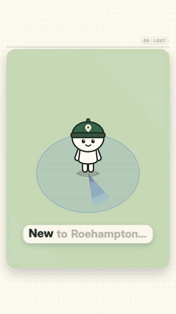

<div align="center">



# Roam

**A game-style campus map for the University of Roehampton.**<br>
Open it from a link or a QR code. No app store, no login.

### [Try it live → roam-roehampton.vercel.app](https://roam-roehampton.vercel.app)

<sub>Unofficial student project. Not affiliated with, or endorsed by, the University of Roehampton.</sub>

</div>

---

## The problem

New students at Roehampton get lost, and the tools they have don't help much:

- The official campus map is a PDF from September 2025, and parts of campus have changed since.
- Café opening hours sit behind a student login.
- A timetable says `Ma101`, but nothing tells you that `Ma` is the Mandela Building.

## What Roam does

- **Tap a building** to see what's inside, its opening hours and a link to the official page. Each fact shows the date it was last checked.
- **Search by name or room code.** Type `Ma101` from your timetable and Roam opens the right building.
- **Walking directions** along real campus paths, with a walking time.
- **Live library hours** from the university's LibCal feed, plus an "Open now" filter for food and study spaces.
- **Find me:** a small avatar shows where you are.
- **Works like an app:** add it to your home screen, use it offline, switch to dark mode.
- **A QR code for every building:** `/?place=library` opens the map with that building's card ready.

## In numbers

| | |
|---|---|
| Places on the map | 77 (47 buildings, 10 food and drink, 5 sport, 4 car parks, 6 outdoor places, 5 entrances) |
| Timetable room-code prefixes | 15 |
| Code | about 4,100 lines of TypeScript and CSS |

## How it's built

| Part | Tool | Notes |
|---|---|---|
| Map | [MapLibre GL](https://maplibre.org) | No map tiles or satellite images. Roam draws only its own campus data, in a low-poly 3D style. |
| Map data | [OpenStreetMap](https://www.openstreetmap.org) (Overpass API) | Node scripts download the campus once and turn it into small GeoJSON files. The app never calls OpenStreetMap itself. |
| Directions | Dijkstra's shortest path | Runs on a walking graph built from campus footpaths (under 1,000 points). |
| App | TypeScript, Vite, PWA | A service worker makes it installable and lets it work offline. |
| Hosting | Vercel | Static site with strict security headers. No backend. |
| Analytics | [Umami](https://umami.is) | Cookieless and anonymous. |

## Privacy and security

- **Your location never leaves your phone.** Roam only uses it to draw you on the map and plan a route.
- No accounts, no cookies, no backend, no API keys in the code.
- A strict Content Security Policy lets the page talk only to itself, the library hours feed and Umami.
- You can turn analytics off: open [roam-roehampton.vercel.app/?notrack](https://roam-roehampton.vercel.app/?notrack).

## Measuring it

I study Business Analytics, so I wanted to measure whether Roam actually helps, not just ship a demo.

- **Umami** counts visits and four events: `place-tap`, `search`, `nav-start` and `install`.
- **A four-question feedback form**, opened from a QR code and fully anonymous.

The questions I want to answer:

1. Which places do students look for most?
2. Do people come back after their first visit?
3. Would students use it every day?

**Results:** collecting now. I'll add them here.

## Built with AI

I designed Roam and built it with [Claude Code](https://claude.com/claude-code) as a pair programmer. The original brief is in [PROMPT.md](PROMPT.md).

## Run it locally

```bash
npm install
npm run dev
```

Editing places, opening hours, photos and deploying: see the [developer notes](docs/DEVELOPMENT.md).

---

Made by **Hüseyin Uzun** · [LinkedIn](https://www.linkedin.com/in/huseyinuzun-data) · [GitHub](https://github.com/UzunHQ)<br>
<sub>Map data © [OpenStreetMap](https://www.openstreetmap.org/copyright) contributors (ODbL).</sub>
